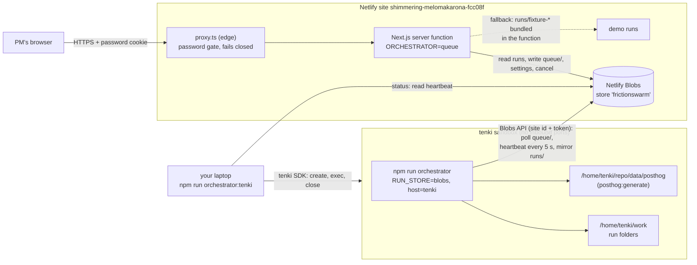

# Deploy: dashboard on Netlify, orchestrator in a tenki sandbox

The dashboard (`apps/dashboard`) runs on the Netlify site
**shimmering-melomakarona-fcc08f**. It never runs the pipeline: **Analyze** only
writes a queued run to Netlify Blobs. The orchestrator daemon
(`npm run orchestrator`) runs in a tenki sandbox. It polls that queue, runs the
pipeline on the sandbox's disk and mirrors every run file back to the same
Blobs store, which the dashboard reads. Nothing connects to the sandbox, and it
exposes no ports. Blobs is the only link.



What each part does:
- **Netlify** builds from `netlify.toml`. It installs the npm workspaces at the repo root and runs `next build` on `apps/dashboard` with `@netlify/plugin-nextjs`. The result is one server function (about 18 MB zipped) plus the proxy, which runs as an edge function.
- **Queue-mode build**: `next.config.ts` swaps `@frictionswarm/pipeline` for a stub, so the pipeline, analyzer, Agent SDK, Playwright, posthog-sim, the worker, `data/posthog` and live runs are not in the bundle. The `RUN_STORE`, `ORCHESTRATOR` and `DASHBOARD_REQUIRE_PASSWORD` values from netlify.toml exist only at build time on Netlify, so they are baked into the bundle (`apps/dashboard/lib/deploy.ts`). Netlify UI env vars still win at runtime.
- **Demo runs**: the `runs/fixture-*` folders are bundled into the function and layered under Blobs as a read-only fallback (`FixtureFallbackStore`). The deployed dashboard shows them with an empty Blobs store, and no seeding is needed.
- **Password gate**: `proxy.ts` / `lib/auth.ts`. When `DASHBOARD_PASSWORD` is unset on Netlify, every page is a 503 "Set DASHBOARD_PASSWORD" page and every API call is a 503 JSON error. Locally the gate stays open without a password.
- **tenki orchestrator**: `packages/pipeline/scripts/tenki-orchestrator.ts`. The `up`, `status`, `logs` and `stop` commands are described below. It is **untested against real tenki**: the unit tests use a mocked SDK.

## Autostart: the site boots the orchestrator itself

You don't have to keep a daemon running. When **Analyze** queues a run and no
heartbeat is fresh, the dashboard pokes `netlify/functions/orchestrator-launch`.
That is a background function: it answers 202 at once and may run for up to
15 minutes. It creates a tenki sandbox, writes the daemon's env file and a
bootstrap script, starts the script detached, and returns. The bootstrap runs
clone → `npm ci` → `posthog:generate` → `npm run orchestrator` inside the
sandbox, so the first heartbeat arrives **3–5 minutes** after the click. While
it boots, /control shows **Starting**. `orchestrator-watch` runs every 5
minutes and launches again if runs are queued and nothing is online or booting.
That covers a missed poke and a sandbox that died during boot. While the
record owns a sandbox and nothing is online, it also pokes the launcher with
an empty queue, so a broken or orphaned sandbox gets closed.

- **One at a time:** `orchestrator-launch.json` in Blobs is the launch record, and every write that claims it is a conditional Blobs write (`onlyIfNew` / `onlyIfMatch` on the etag), so two launchers can't both win. A new launch happens only when there's no fresh heartbeat and one of these holds: no record exists; the record is `closing`; the sandbox never sent a heartbeat within 20 minutes of launch; its daemon was online and its heartbeat has been quiet for 3 minutes; or the last launch failed long enough ago (5 minutes, doubling per failure in a row, at most 1 hour). A stale sandbox from an earlier launch is closed first.
- **Failed boot:** the bootstrap script writes `~/bootstrap.status` (`booting`, `started`, or `failed: exit N at line L`). While a launch is booting, the launcher reads it; on a failure it closes the sandbox and records the error with the log tail, which /control shows.
- **Idle shutdown:** the autostarted daemon gets `ORCHESTRATOR_IDLE_EXIT_MS` (default 30 min). After that long with nothing running or queued, it marks the launch record `closing` and closes its own sandbox. If that close fails, the launcher closes it on the next poke.
- **Time limit:** `TENKI_MAX_HOURS` (default 3 for autostart) is the hard ceiling. The daemon gets the deadline as `ORCHESTRATOR_DEADLINE`. From 30 minutes before it (`ORCHESTRATOR_DRAIN_MS`), it takes no new runs, lets the active ones finish, then shuts down like an idle exit, and the next poke launches a fresh sandbox for what is still queued.
- **Secret:** the launcher accepts only requests carrying `AUTH_SECRET` (or `DASHBOARD_PASSWORD`) in `x-frictionswarm-launch`. The password gate (`proxy.ts`) skips `/.netlify/functions/`. Even with the secret, the launcher does nothing unless runs are queued.
- **Code:** `packages/store/src/launch.ts`, shared with the `npm run orchestrator:tenki` CLI.
- **Credentials:** the autostart forwards `TENKI_API_KEY` into the sandbox, unlike the CLI. Its daemon needs the key for the tenki swarm, the real fix loop and its own shutdown.

Set these in the Netlify UI (Functions scope), on top of `DASHBOARD_PASSWORD`:

| Name | Required | Notes |
|---|---|---|
| `TENKI_API_KEY` | **yes** | creates the sandbox; also forwarded into it |
| `NETLIFY_AUTH_TOKEN` | **yes** | the daemon writes Blobs from outside Netlify. `NETLIFY_SITE_ID` is taken from the function's context when unset |
| `GITHUB_TOKEN` | for `FIX_LOOP=real` | clone, push and open the storefront PR |
| `CLAUDE_CODE_OAUTH_TOKEN` or `ANTHROPIC_API_KEY` | for real runs | coding agent, swarm agents, model-written findings |
| `TENKI_SNAPSHOT_ID` | for `SWARM_RUNNER=tenki` | the swarm's Chrome snapshot |
| `SWARM_RUNNER`, `FIX_LOOP`, `POSTHOG_*`, `PRODUCTION_BUILD_SHA`, ... | optional | forwarded as with the CLI (`FORWARDED_ENV`) |
| `ORCHESTRATOR_REF` | optional | branch the sandbox clones, default `main` |
| `ORCHESTRATOR_IDLE_EXIT_MS`, `TENKI_MAX_HOURS`, `ORCHESTRATOR_DRAIN_MS` | optional | idle shutdown (default 30 min), sandbox lifetime (default 3 h), and how long before it the daemon stops taking runs (default 30 min) |

The rest of this page (the CLI) still works. Use it to run a branch, follow the logs, or stop a sandbox by hand.

## Environment variables

| Name | Where it is set | Required | Example / notes |
|---|---|---|---|
| `DASHBOARD_PASSWORD` | Netlify UI (Functions scope, all contexts) | **yes** | `a-long-passphrase`. Without it the site serves only the "Set DASHBOARD_PASSWORD" page |
| `AUTH_SECRET` | Netlify UI | optional | random 32+ chars. Signs the login cookie; defaults to the password |
| `POSTHOG_PROJECT_ID`, `POSTHOG_APP_HOST` | Netlify UI | optional | `12345`, `https://us.posthog.com`. Session-replay links on findings |
| `POSTHOG_PERSONAL_API_KEY`, `POSTHOG_HOST` | Netlify UI | only for the `api` source | `phx_...`, `https://us.i.posthog.com`. The dashboard reads a live re-test's swarm tracks from PostHog |
| `CLAUDE_CODE_OAUTH_TOKEN` / `ANTHROPIC_API_KEY` | Netlify UI only for the autostart. Root `.env.local` → tenki env | optional | Analysis runs in the sandbox, not on Netlify. Without a key the analyzer uses its heuristic |
| `RUN_STORE` | `netlify.toml` (build) → baked | set | `blobs` |
| `ORCHESTRATOR` | `netlify.toml` (build) → baked | set | `queue` (Analyze only enqueues). Locally: `inline` (default) or `queue` |
| `DASHBOARD_REQUIRE_PASSWORD` | `netlify.toml` (build) → baked | set | `1`: fail closed |
| `NODE_VERSION` | `netlify.toml` (build) | set | `22` |
| `TENKI_API_KEY` | root `.env.local` (laptop only) | **yes** for tenki | the **tenki3** key, `tk_...`. The SDK also reads `TENKI_AUTH_TOKEN`. Never sent into the sandbox |
| `NETLIFY_SITE_ID` | root `.env.local` → tenki env | **yes** for tenki | `3f4a82b8-25c2-4073-9ab0-acfbac435e44` (this site's project ID) |
| `NETLIFY_AUTH_TOKEN` | root `.env.local` → tenki env | **yes** for tenki | `nfp_...`, a Netlify personal access token (Blobs API) |
| `TENKI_CHROME_SNAPSHOT_ID` | root `.env.local` | optional | `snap_...`. Boot from P2's snapshot instead of the base image |
| `TENKI_MAX_HOURS` | root `.env.local` | optional | `8` (default). The sandbox terminates after this |
| `TENKI_REPO_REF`, `TENKI_REPO_URL` | root `.env.local` | optional | default: your current branch (must be pushed) on `github.com/jbecerra73/build101_grupo16` |
| `GITHUB_TOKEN` | root `.env.local` → tenki env | optional | only for a private repo or `FIX_LOOP=real`. Passed to `git clone` via env, then origin is reset |
| `SWARM_RUNNER`, `SWARM_SPEED`, `FIX_LOOP`, `FIX_STAGE_DELAY_MS`, `MAX_RUNS_PER_DAY`, `DEFAULT_SEEDS_PER_PERSONA`, `POSTHOG_*`, `PRODUCTION_BUILD_SHA`, `NETLIFY_BLOBS_STORE` | root `.env.local` → tenki env | optional | forwarded into the sandbox when set (see `FORWARDED_ENV`) |
| `RUN_STORE=blobs`, `ORCHESTRATOR_HOST=tenki`, `TENKI_SANDBOX_ID`, `ORCHESTRATOR_VERSION`, `ORCHESTRATOR_WORK_DIR=/home/tenki/work`, `POSTHOG_DATA_DIR`, `SWARM_SHOTS_DIR` | tenki env (`/home/tenki/orchestrator.env`, 0600) | written by `up` | do not set these yourself |

`npm run orchestrator:tenki` loads the repo-root `.env.local`. Shell variables
win over the file, and the file is gitignored.

## Checklist for the manual CLI (the code never changes Netlify settings; with the autostart variables above it does create sandboxes)

### 1. Netlify environment variables
Open https://app.netlify.com/projects/shimmering-melomakarona-fcc08f, then
**Project configuration → Environment variables → Add a variable**. Use scope
**Functions** (or all scopes) and **Same value for all deploy contexts**.
- `DASHBOARD_PASSWORD`: required.
- `AUTH_SECRET`: optional.
- `POSTHOG_PROJECT_ID`, `POSTHOG_APP_HOST`: optional, for replay links. Add `POSTHOG_PERSONAL_API_KEY` and `POSTHOG_HOST` only if you will use the PostHog **api** source.
- Add `CLAUDE_CODE_OAUTH_TOKEN` here only for the autostart (see above), which forwards it to the sandbox. The site itself never calls a model.

Then go to **Deploys → Trigger deploy → Deploy site** (env changes need a new deploy).

> The site also has Netlify's own **visitor access control** on: production and
> previews answer with Netlify's "Login Redirect" (401, `app.netlify.com/edge-access`)
> before the app runs. You can keep it (two locks) or turn it off under
> **Project configuration → Access & security → Visitor access** so that only the
> dashboard password is needed.

### 2. Netlify personal access token and site id (for the orchestrator)
- Token: https://app.netlify.com/user/applications#personal-access-tokens, then **New access token**. Name it `frictionswarm-orchestrator` and pick a short expiry (e.g. 7 days). Copy the `nfp_...` value. It can write to all your sites, so keep it in `.env.local` only.
- Site id: **Project configuration → General → Project information → Project ID**. For this site it is `3f4a82b8-25c2-4073-9ab0-acfbac435e44`.

### 3. Root `.env.local`
```bash
# <repo>/.env.local  (gitignored)
TENKI_API_KEY=<the tenki3 key, tk_...>
NETLIFY_SITE_ID=3f4a82b8-25c2-4073-9ab0-acfbac435e44
NETLIFY_AUTH_TOKEN=nfp_...
# optional
# TENKI_CHROME_SNAPSHOT_ID=snap_...
# CLAUDE_CODE_OAUTH_TOKEN=...        # model-written findings in the sandbox
```

### 4. Start the orchestrator in tenki
```bash
npm install
npm run orchestrator:tenki -- up               # clones your current branch; it must be pushed
# or: npm run orchestrator:tenki -- up --ref main
# or: npm run orchestrator:tenki -- up --tarball   # uploads the working tree (minus node_modules, data, runs, .env*)
```
`up` creates the sandbox (4 CPU, 8 GB, 20 GB disk, at most `TENKI_MAX_HOURS`). It then:
1. clones the repo into `/home/tenki/repo`;
2. runs `npm ci` and `npm run posthog:generate`;
3. writes `/home/tenki/orchestrator.env`;
4. starts `npm run orchestrator` detached, logging to `/home/tenki/orchestrator.log`;
5. waits up to 90 s for the heartbeat in Blobs.

The sandbox id is saved in `.tenki-orchestrator.json` (gitignored). If any step fails, the sandbox is closed, because failed sessions still bill. Pass `--keep-on-failure` to keep it for inspection.

### 5. Verify
1. `npm run orchestrator:tenki -- status` shows `heartbeat: online, host=tenki sandbox=<id>` and `sandbox: <id> RUNNING, orchestrator process running`.
2. Open the site, log in, and go to **/control**. Under **Orchestrator** you should see **Online** with host **tenki** (cloud icon).
3. Click **Analyze** and keep the defaults. The run page shows "Queued: waiting for the orchestrator", then analyzing → fixing → … → done. Use `npm run orchestrator:tenki -- logs --follow` to watch the sandbox side.
4. The `fixture-*` demo runs appear in **Runs** even before any live run.

### 6. Stop and roll back
- Stop the orchestrator (terminates the sandbox, which stops billing): `npm run orchestrator:tenki -- stop`. Within 20 s `/control` shows the orchestrator offline, and new runs stay queued.
- If the heartbeat goes offline while the sandbox is still running: run `status`, then `logs`, then `stop` and `up`. The daemon is a plain background process, and a tenki guest-agent restart kills it. Runs it had in flight are marked failed ("orchestrator restarted") on the next start, and **Retry** re-queues them.
- Without tenki, run the same daemon from your laptop against the site's Blobs:
  `RUN_STORE=blobs NETLIFY_SITE_ID=... NETLIFY_AUTH_TOKEN=... npm run orchestrator` (host shows "local").
- To roll back the site, go to **Deploys**, pick the previous production deploy and click **Publish deploy**, or revert the merge commit on `main`.
- When the hackathon is over, revoke the Netlify token (step 2) and the tenki key.

## Local checks

```bash
npm run typecheck && npm test
# queue mode with two processes, like production:
ORCHESTRATOR=queue RUN_STORE=fs npm run dashboard     # Analyze only enqueues
RUN_STORE=fs npm run orchestrator                     # takes the queue; /control shows host "local"
# the Netlify build without deploying (no login needed):
npx netlify-cli build --offline                        # writes .netlify/ (gitignored)
```
